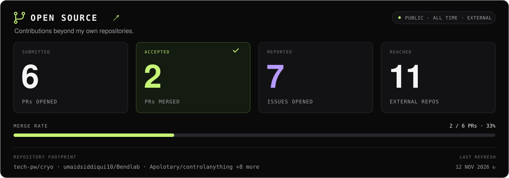

<div align="center">

<picture>
  <source media="(prefers-color-scheme: dark)" srcset="https://raw.githubusercontent.com/Yash-Tripath1/Yash-Tripath1/main/assets/banner-dark.svg">
  <source media="(prefers-color-scheme: light)" srcset="https://raw.githubusercontent.com/Yash-Tripath1/Yash-Tripath1/main/assets/banner-light.svg">
  
</picture>

<br>

<a href="https://anadi-dev.vercel.app"></a>&nbsp;
<a href="https://www.linkedin.com/in/anadi-tripathi-4a33543a6"></a>&nbsp;
<a href="https://github.com/glymph-studio"></a>

</div>

---

### about

- co-founder of **Glymph Studio**, an indie dev collective that ships tools fast and open
- running open research alongside the apps: simulation and replication studies with code, paper and a Zenodo archive
- build end to end: a browser engine in Python, a language model trained from scratch, desktop apps on Electron
- dual degree: **BCA** at University of Lucknow + **BS in Data Science** at IIT Madras 
- into **AI/ML, automation and cybersecurity**; learning in public, one repo at a time
- reach me on [LinkedIn](https://www.linkedin.com/in/anadi-tripathi-4a33543a6) or through the [portfolio](https://anadi-dev.vercel.app)

<!-- OPEN_SOURCE:START -->
### open source

<div align="center">

<picture>
  <source media="(prefers-color-scheme: dark)" srcset="https://raw.githubusercontent.com/Yash-Tripath1/Yash-Tripath1/main/assets/open-source-dark.svg">
  <source media="(prefers-color-scheme: light)" srcset="https://raw.githubusercontent.com/Yash-Tripath1/Yash-Tripath1/main/assets/open-source-light.svg">
  
</picture>

<sub>Public, all-time activity outside my own account. PRs and issues counted separately.</sub><br>
<a href="https://github.com/search?q=author%3AYash-Tripath1+is%3Apublic+-user%3Ayash-tripath1+is%3Apr&amp;type=pullrequests">Pull requests ↗</a> · <a href="https://github.com/search?q=author%3AYash-Tripath1+is%3Apublic+-user%3Ayash-tripath1+is%3Aissue&amp;type=issues">Issues ↗</a>

</div>
<!-- OPEN_SOURCE:END -->

### featured work

<div align="center">

<picture>
  <source media="(prefers-color-scheme: dark)" srcset="https://raw.githubusercontent.com/Yash-Tripath1/Yash-Tripath1/main/assets/featured-dark.svg">
  <source media="(prefers-color-scheme: light)" srcset="https://raw.githubusercontent.com/Yash-Tripath1/Yash-Tripath1/main/assets/featured-light.svg">
  
</picture>

</div>

### stack

```yaml
languages:   [ Python, TypeScript, JavaScript, HTML/CSS, Luau ]
frameworks:  [ React, Vite, Node/Express, Tailwind, Electron, three.js ]
ai_and_data: [ LLM APIs (Groq), model training from scratch, sim + power analysis, llama.cpp, prompt design ]
tooling:     [ Linux, Git, Docker, Firebase, Vercel, n8n, Ollama ]
```

### contributions

<div align="center">

<picture>
  <source media="(prefers-color-scheme: dark)" srcset="https://raw.githubusercontent.com/Yash-Tripath1/Yash-Tripath1/output/github-contribution-grid-snake-dark.svg">
  <source media="(prefers-color-scheme: light)" srcset="https://raw.githubusercontent.com/Yash-Tripath1/Yash-Tripath1/output/github-contribution-grid-snake.svg">
  
</picture>

</div>

---

<div align="center">
<sub>banner, featured strip and open-source panel are generated by the scripts in <code>/scripts</code></sub>
</div>
